# Minimalne modele 7 problemów milenijnych

**OSTRZEŻENIE:** Nie cytuj żadnej propozycji z repozytorium `millennium-models` jako dowodu. Każda propozycja dla problemu otwartego ma brakujący krok, którego dowodu autor nie zna.

## Streszczenie

Repozytorium sprowadza 7 problemów milenijnych do 3 modeli. W modelu teza ma dowód z co najwyżej 4 wierszy albo sprawdzian liczbowy. Repozytorium nie zawiera dowodu żadnego problemu otwartego: każda propozycja kończy się nazwanym brakującym krokiem. Algorytm 2 wątków szuka na przemian dowodu i kontrprzykładu. Wątek kontrprzykładów istnieje dla hipotezy Riemanna i nie znalazł naruszenia dla $n$ od 2 do 1 000 000 włącznie. 4 symulacje i 18 rysunków pokazują modele w 2 wymiarach i w 3 wymiarach.

12 dowodów zawiera sekcja „Najkrótsze dowody” w pliku [REPORT.md](REPORT.md). Każdy dowód ma co najwyżej 4 wiersze. Żaden dowód nie dotyczy problemu otwartego.

Autor: Maciej Szulia, maciej.szulia@gmail.com

## Pliki

| Plik | Zawartość |
|---|---|
| [REPORT.md](REPORT.md) | Raport: streszczenie, 12 dowodów, 3 modele, 7 propozycji, propozycje uzupełnienia brakujących kroków, algorytm, 14 sprawdzianów, uproszczenia, zastosowania, problematyka, dyskusja, bibliografia. |
| [references-check.md](references-check.md) | Wynik sprawdzenia 40 odsyłaczy z 2026-11-13: dane pozycji, DOI, stan potwierdzenia każdego twierdzenia. |
| [models_check.py](models_check.py) | 14 sprawdzianów. Jeżeli co najmniej 1 sprawdzian daje liczby niezgodne z twierdzeniem albo z raportem, to skrypt kończy pracę błędem. |
| [simulations.py](simulations.py) | 4 symulacje: przepływ skracający krzywą, wirowość w 2 wymiarach, orbity w potencjale $x^2y^2$, przeszukiwanie formuł 3-SAT. |
| [figures.py](figures.py) | Skrypt, który rysuje 14 rysunków PNG w bibliotekach matplotlib i seaborn. |
| [animations.py](animations.py) | Skrypt, który rysuje 3 animacje GIF i 1 rysunek PNG w bibliotece matplotlib. |
| [interactive.py](interactive.py) | Skrypt, który buduje stronę z 14 rysunkami interaktywnymi w bibliotece plotly. |
| [docs/index.html](docs/index.html) | Strona z 14 rysunkami interaktywnymi. |
| [figures](figures) | 15 rysunków PNG i 3 animacje GIF. |
| [LICENSE](LICENSE) | Licencja MIT. |

## 3 modele i 1 algorytm

| Element | Opis | Problemy |
|---|---|---|
| Model 1 | Powierzchnia $E \times E$ z 4 krzywymi i z liczbą przecięć krzywych. | Riemann, Birch i Swinnerton-Dyer (BSD), Hodge |
| Model 2 | 1 liczba na każdą skalę długości. Model pyta, w którą stronę liczba zmienia się, gdy skala maleje. | Poincaré, Yang–Mills, Navier–Stokes |
| Model 3 | Liczba zapytań algorytmu i liczba bramek obwodu. | P a NP |
| Algorytm 2 wątków | Pętla, która na przemian sprawdza teksty jako dowody i kandydatów na kontrprzykład. | każdy z 7 problemów |

## Rysunki interaktywne

Plik `docs/index.html` zawiera 14 rysunków interaktywnych. 5 rysunków w 3 wymiarach obraca się myszą, a 2 rysunki mają suwak czasu. Wykonaj każdy krok w tej kolejności:

1. Pobierz repozytorium: `git clone https://github.com/maciejszulia/millennium-models.git`.
2. Otwórz plik `docs/index.html` w przeglądarce z WebGL.

Strona pobiera biblioteki plotly.js i MathJax z sieci.

## Rysunki

Tytuł każdego rysunku podaje wniosek. Podtytuł podaje, co rysunek przedstawia. Stopka podaje źródło liczb.

### 1. Hipoteza Riemanna

Brakujący krok: odpowiednik powierzchni $E \times E$ z formą przecięcia dla pierścienia liczb całkowitych.

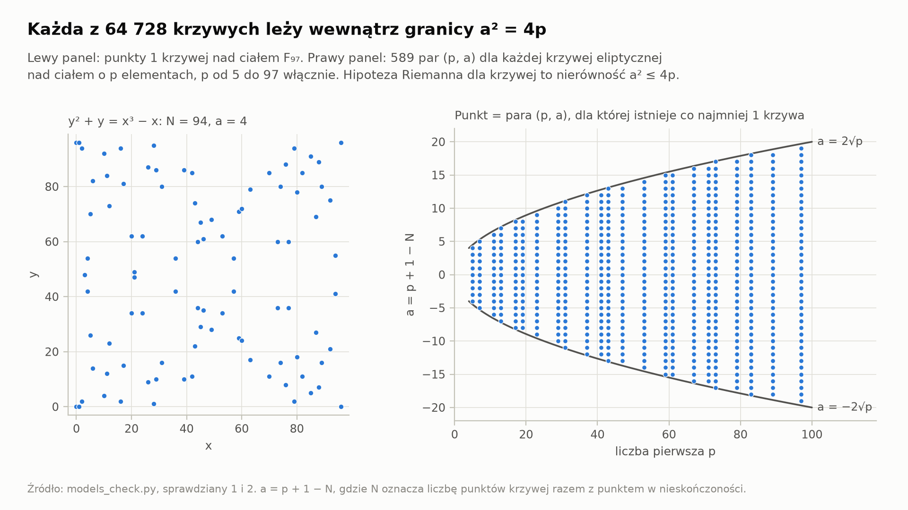

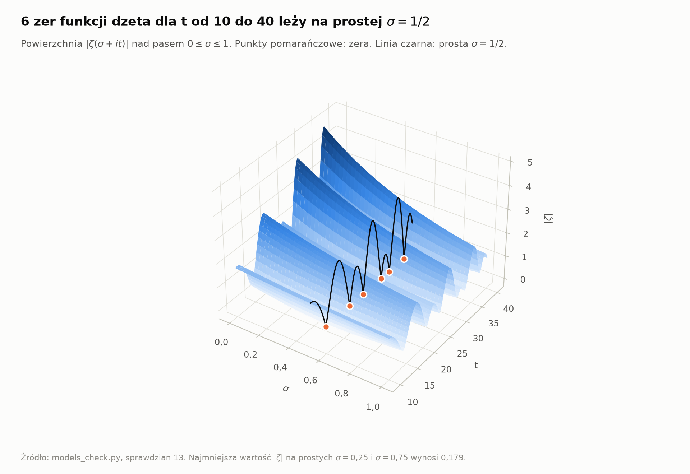

### 2. Hipoteza Bircha i Swinnertona-Dyera

Brakujący krok: skończoność grupy Tate'a–Szafarewicza dla krzywych o randze co najmniej 2.

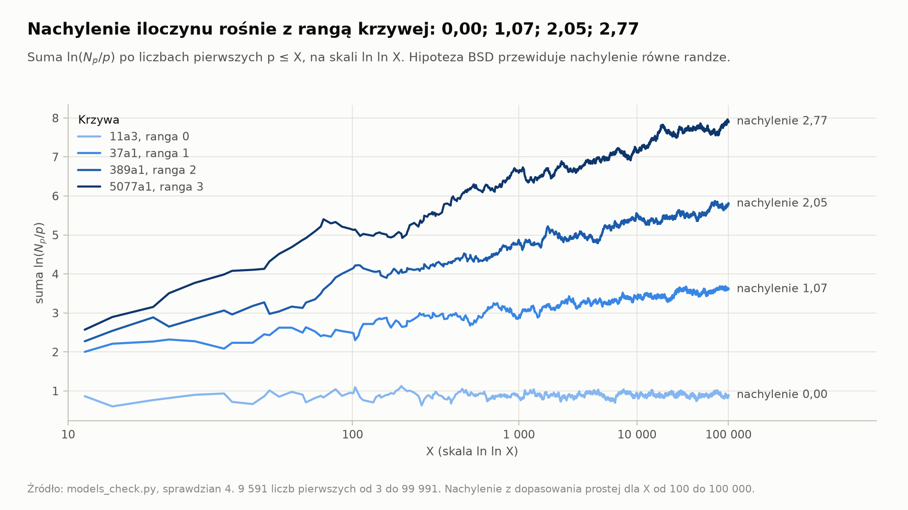

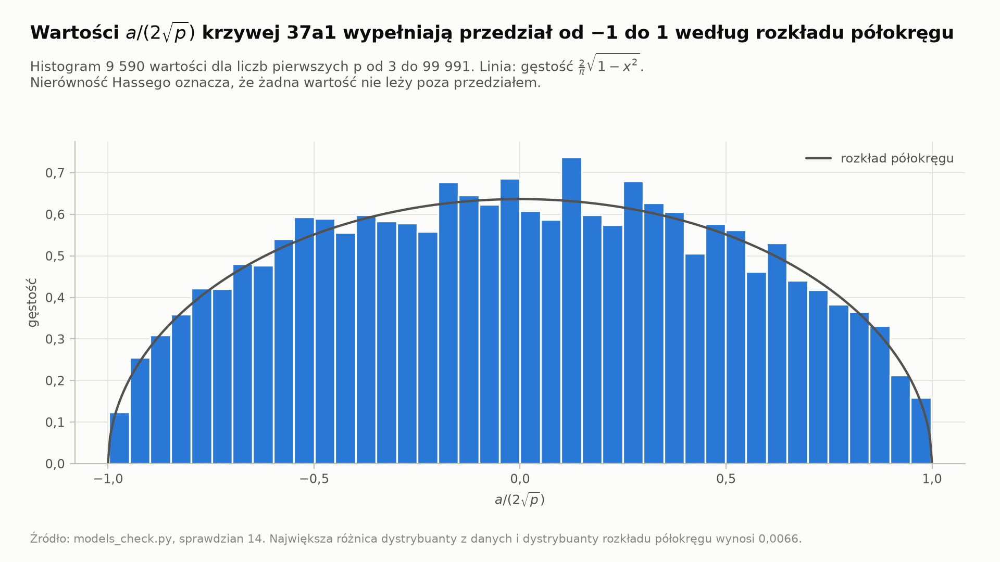

### 3. Hipoteza Hodge'a

Brakujący krok: konstrukcja podrozmaitości dla klasy typu $(k,k)$ przy $k \ge 2$.

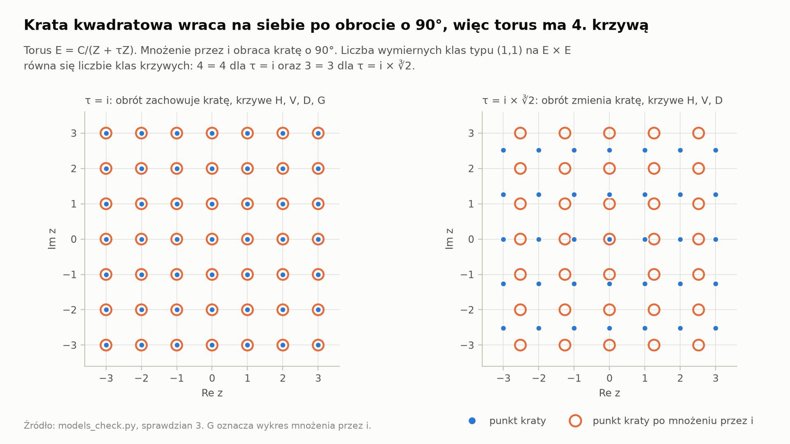

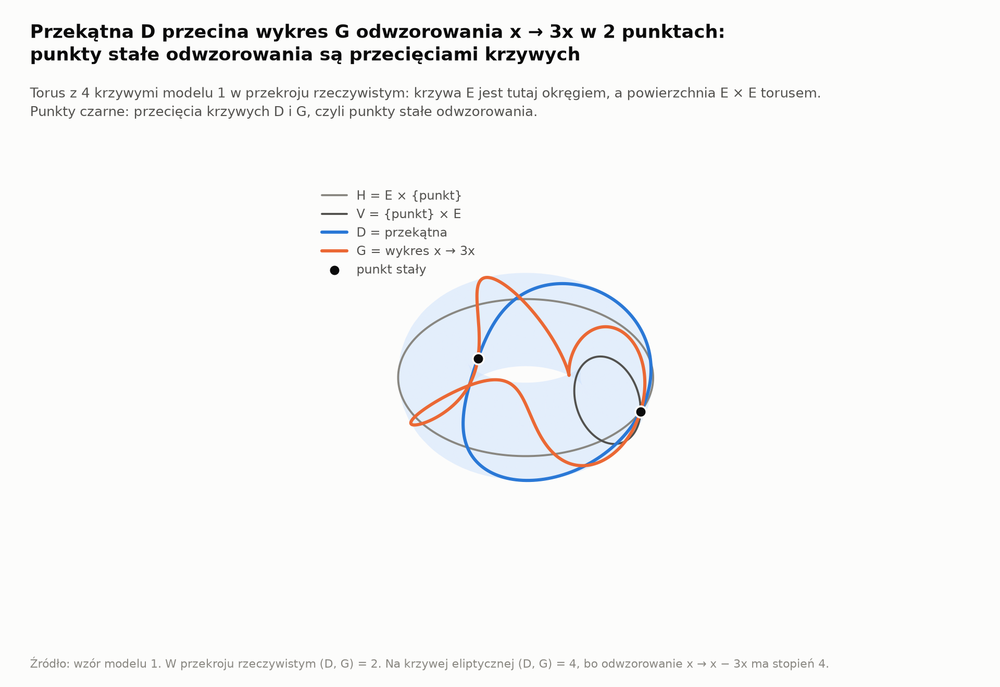

### 4. Teoria Yanga–Millsa i luka masowa

Brakujący krok: dolne ograniczenie odstępu $E_1 - E_0$, które pozostaje dodatnie w nieskończonej objętości.

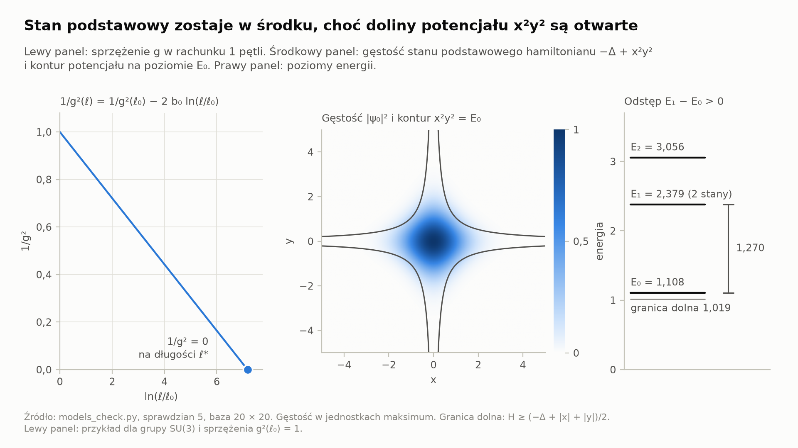

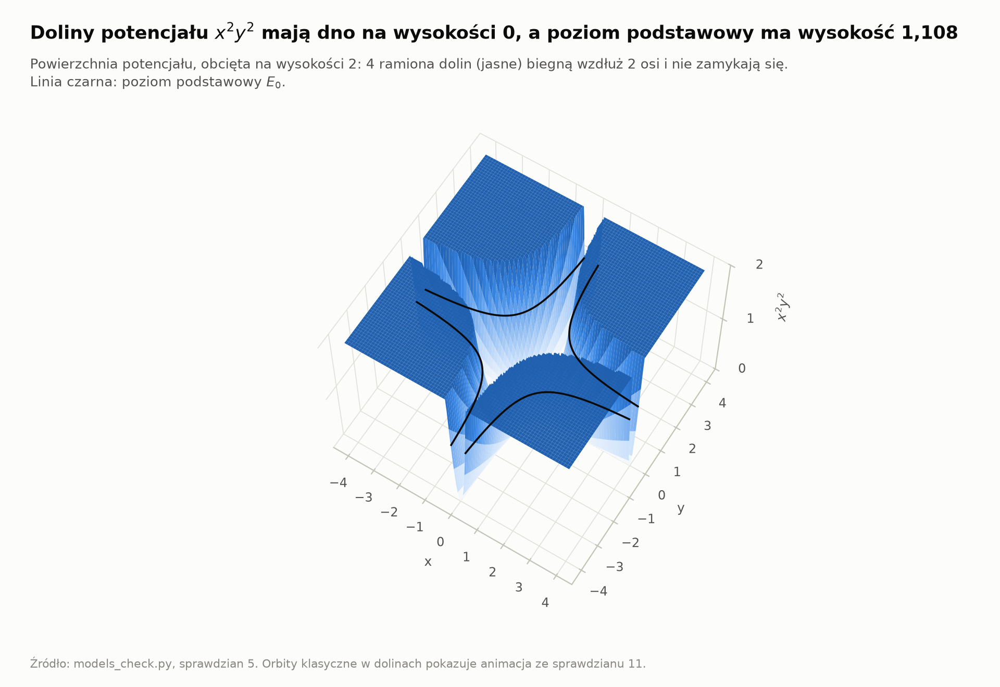

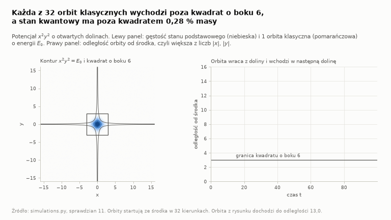

### 5. Równania Naviera–Stokesa

Brakujący krok dla ruchu bez siły zewnętrznej: kres górny ułamka $\theta$ dla prawdziwego równania.

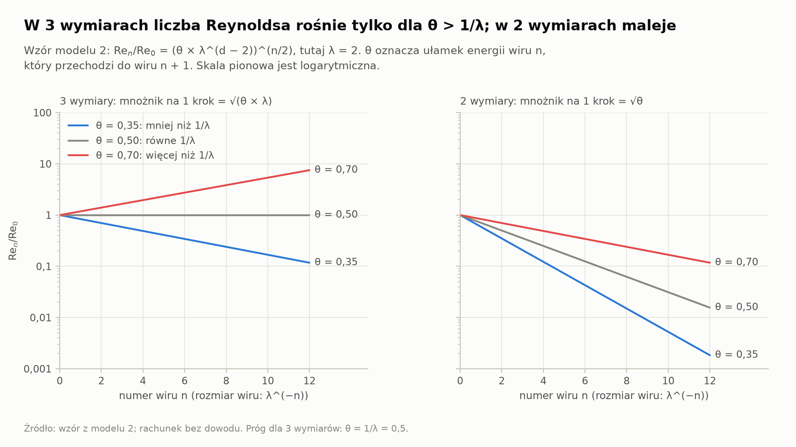

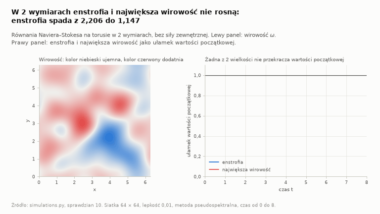

### 6. Problem P a NP

Brakujący krok: dolne ograniczenie liczby bramek dla funkcji z klasy NP, które przewyższa każdy wielomian zmiennej $n$.

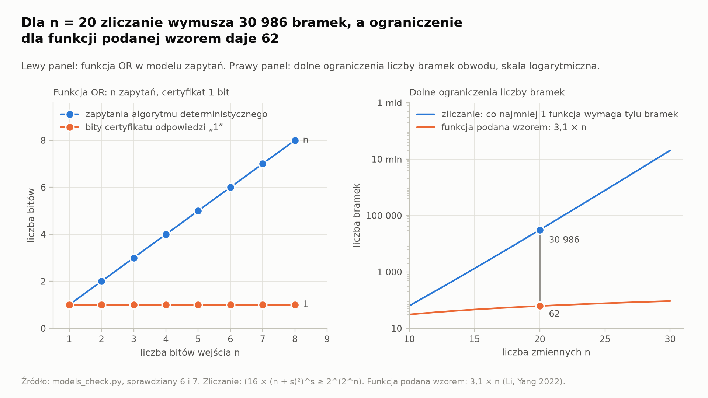

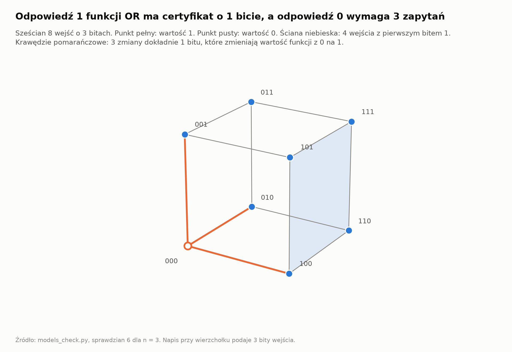

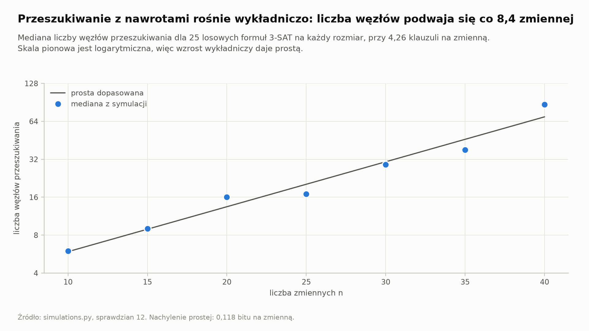

### 7. Hipoteza Poincarégo

Dowód istnieje (Perelman 2002, 2003a, 2003b). Model 2 odtwarza szkielet dowodu na okrągłej sferze.

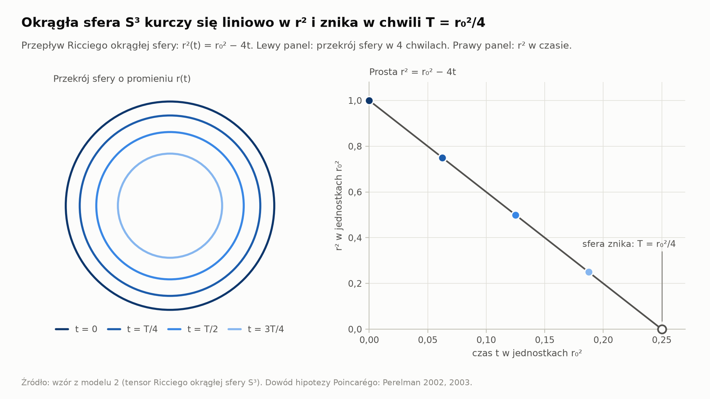

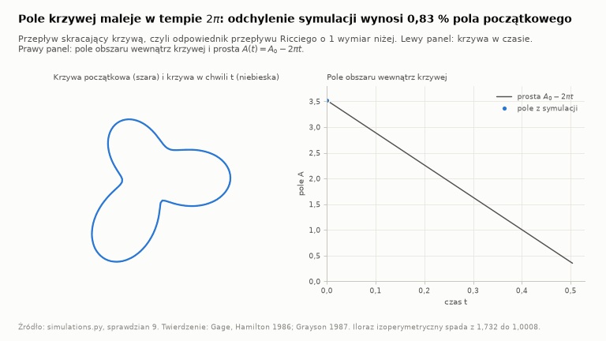

### 8. Algorytm 2 wątków

Algorytm kończy pracę, gdy istnieje dowód, obalenie albo kontrprzykład. Żaden algorytm nie rozpoznaje przypadku, w którym teoria nie rozstrzyga tezy.

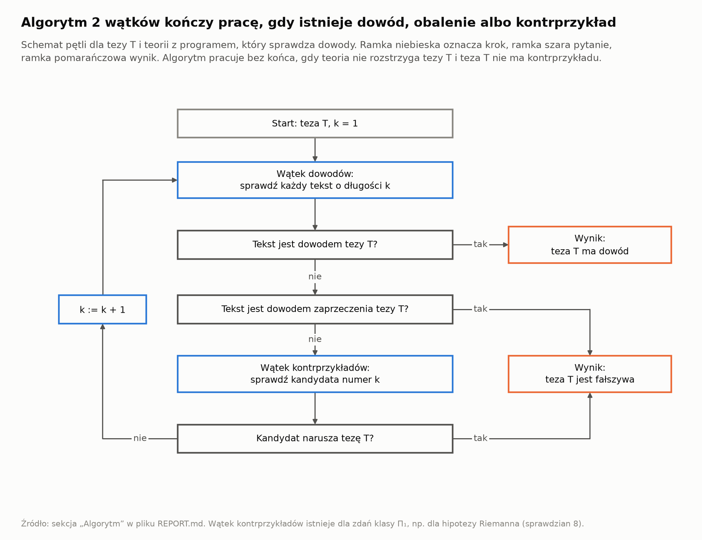

### 9. Wątek kontrprzykładów dla hipotezy Riemanna

Hipoteza Riemanna jest równoważna 1 nierówności dla liczb naturalnych (Lagarias 2002). Sprawdzian 8 nie znalazł naruszenia nierówności.

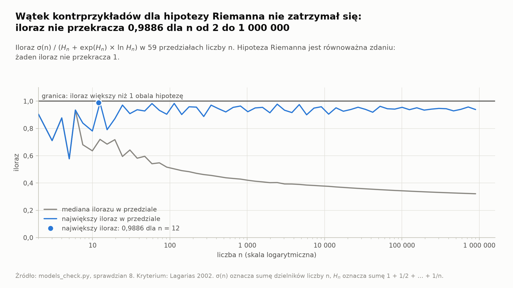

## Jak powtórzyć obliczenia

Wykonaj każdy krok w tej kolejności:

1. Utwórz środowisko: `python3 -m venv .venv`.
2. Zainstaluj biblioteki: `.venv/bin/pip install -r requirements.txt`.
3. Uruchom sprawdziany: `.venv/bin/python models_check.py`. Wynik: skrypt wypisuje wiersz `all checks passed`.
4. Narysuj rysunki: `.venv/bin/python figures.py`. Wynik: katalog `figures` zawiera 14 plików PNG z tego skryptu.
5. Narysuj animacje: `.venv/bin/python animations.py`. Wynik: katalog `figures` zawiera 3 pliki GIF i 1 plik PNG z tego skryptu.
6. Zbuduj stronę interaktywną: `.venv/bin/python interactive.py`. Wynik: plik `docs/index.html`.

Czasy pracy 4 skryptów: `models_check.py` 23 s, `figures.py` 27 s, `animations.py` 66 s, `interactive.py` 24 s. Pomiar: 1 przebieg z 2026-11-13, laptop autora z 8 wątkami procesora.

## Problematyka

- Sprawdzian obejmuje skończoną liczbę przypadków. Sprawdzian nie jest dowodem. Symulacja przybliża ruch z błędem kroku czasu.
- Autor nie udowodnił żadnego brakującego kroku.
- Sprawdzenie odsyłaczy z 2026-11-13 objęło tekst 4 prac i abstrakty 5 prac. 26 twierdzeń ma potwierdzenie tylko w źródle wtórnym, a 4 twierdzenia nie mają potwierdzenia.
- Pełną listę zawiera sekcja „Problematyka” w pliku [REPORT.md](REPORT.md).
