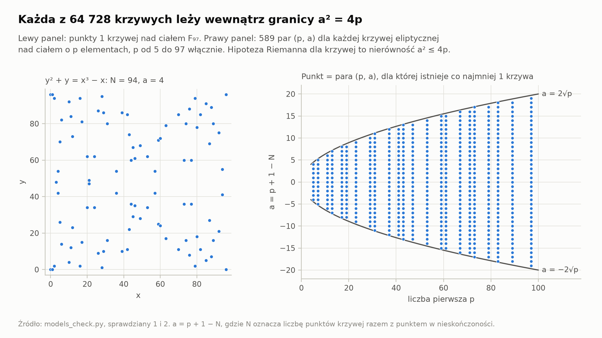
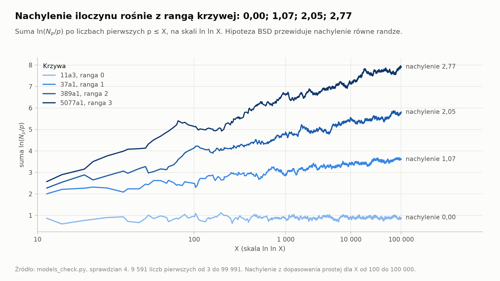
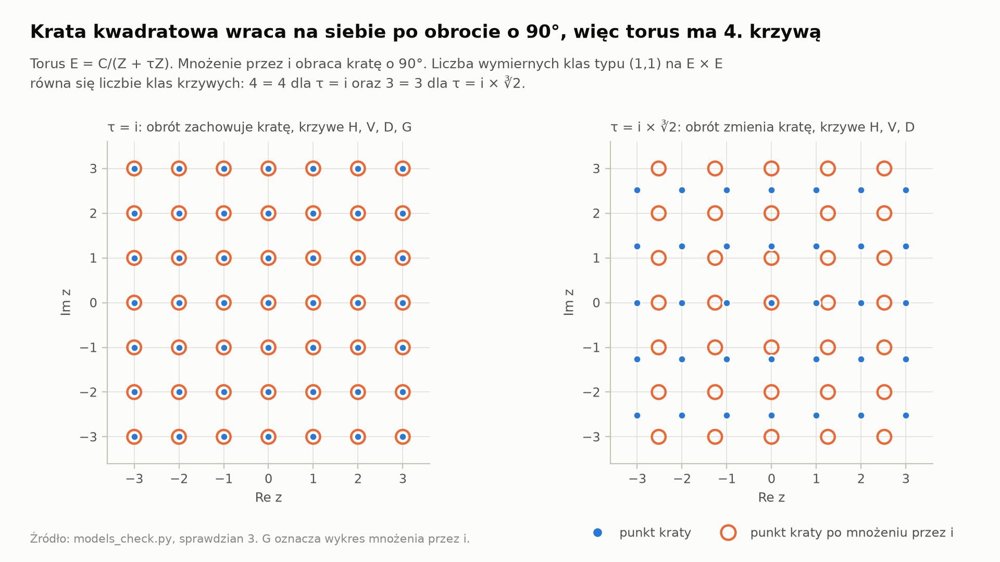
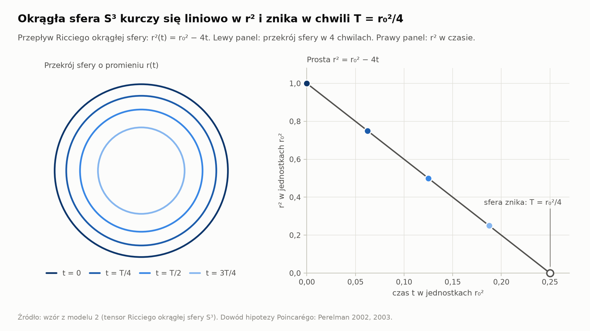
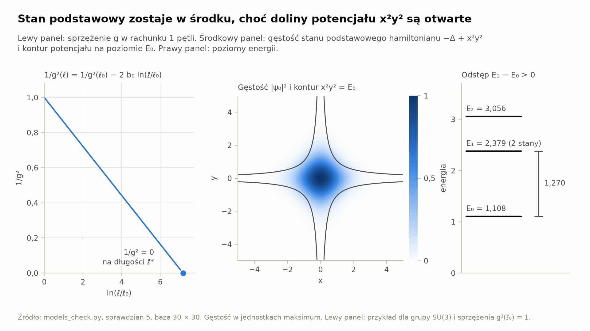
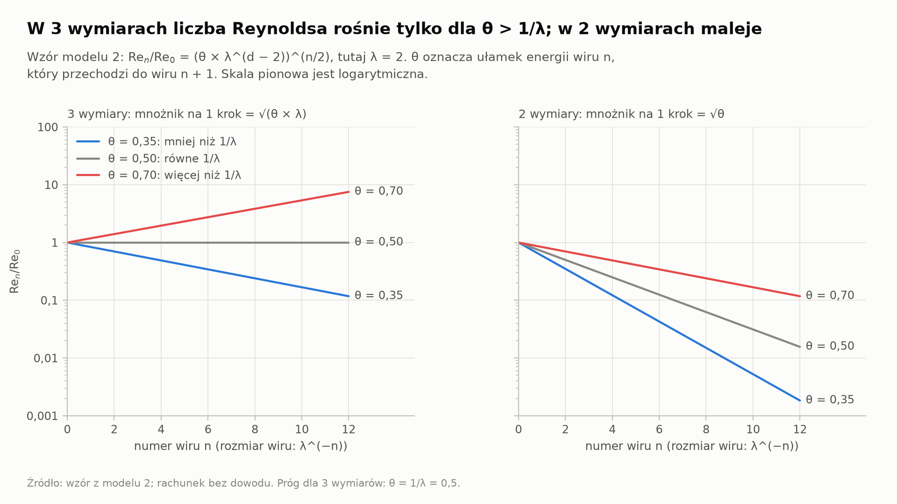
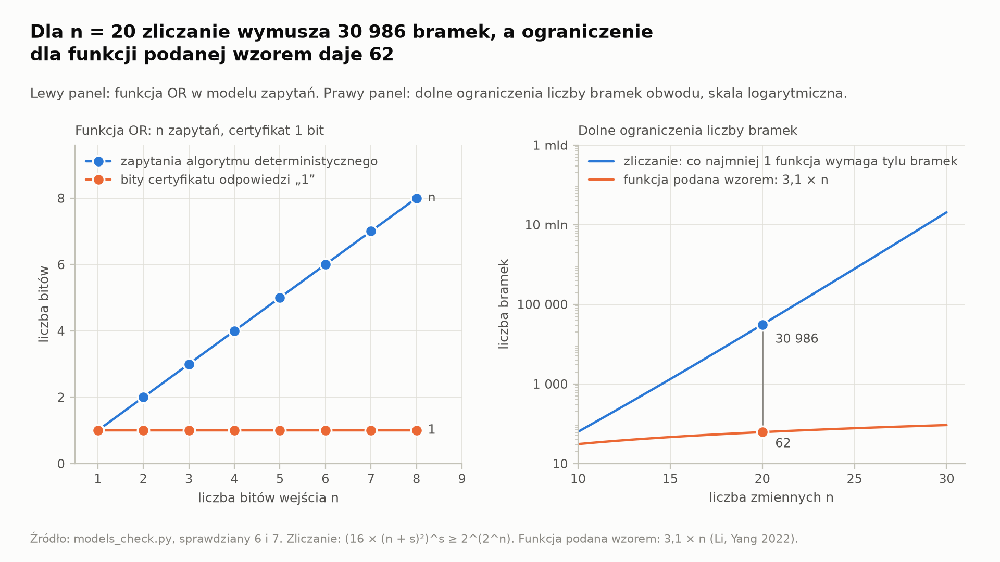

# Minimalne modele 7 problemów milenijnych: 3 modele, 7 propozycji, 7 sprawdzianów

Maciej Szulia, maciej.szulia@gmail.com

Raport opisuje stan z dnia 2026-11-13.

**OSTRZEŻENIE:** Nie cytuj żadnej propozycji z raportu jako dowodu. Każda propozycja dla problemu otwartego ma brakujący krok, którego dowodu autor nie zna.

## Wynik

- Raport podaje 7 propozycji i 3 modele. Raport nie zawiera dowodu żadnego problemu otwartego.
- Skrypt wykonuje 7 sprawdzianów. 6 sprawdzianów daje liczby zgodne z twierdzeniem w modelu `[obliczenie: skrypt]`.
- Sprawdzian 4 daje liczby zgodne z hipotezą BSD dla rang 0, 1, 2 oraz odchylenie 0,23 dla rangi 3 `[obliczenie: skrypt]`.
- 2 problemy zmieniły stan w 2026 r.: Navier–Stokes i Yang–Mills `[źródło: sieć]`.
- Wspólna zasada 7 propozycji: wskaż 1 wielkość, która ma stały znak albo zmienia się w 1 kierunku.

Legenda: znacznik `[obliczenie: skrypt]` oznacza liczbę, którą obliczył plik `models_check.py`. Znacznik `[źródło: autor rok]` wskazuje pracę z sekcji „Bibliografia”. Autor nie sprawdził żadnego odsyłacza w pracy źródłowej. Znacznik `[źródło: sieć]` wskazuje sekcję „Źródła z sieci”, czyli streszczenia wyników wyszukiwania z 2026-11-13. Autor nie otworzył stron źródłowych. Znacznik `[założenie]` oznacza zdanie bez dowodu i bez sprawdzenia.

## Słownik

| Termin | Definicja | Słowa zakazane dla tego pojęcia |
|---|---|---|
| model | Obiekt matematyczny, w którym odpowiednik tezy problemu ma opublikowany dowód. | uproszczenie, przybliżenie |
| twierdzenie w modelu | Zdanie o modelu, które ma opublikowany dowód. | fakt |
| brakujący krok | Zdanie bez opublikowanego dowodu, które przenosi twierdzenie w modelu na pełny problem. | dziura |
| propozycja | Plan dowodu, który nazywa model, twierdzenie w modelu i brakujący krok. | rozwiązanie, dowód |
| sprawdzian | Obliczenie skryptu, które porównuje liczby z twierdzeniem w modelu albo z hipotezą. | test, dowód |

## Stan problemów w dniu 2026-11-13

| Problem | Stan | Znacznik |
|---|---|---|
| Poincaré | Dowód istnieje. Clay Mathematics Institute (CMI) przyznał nagrodę w 2010 r. | `[źródło: Perelman 2002, 2003]` |
| Navier–Stokes | OpenAI ogłosił 2026-09-08 dowód wariantów (C) i (D): osobliwość przy gładkiej sile zewnętrznej. W dniu 2026-09-18 niezależna weryfikacja wariantu (C) trwała. Praca z 2026-10-06 podważa zgodność formalizacji w Lean z dowodem słownym. Pytanie o ruch bez siły nie ma dowodu. | `[źródło: sieć]` |
| Yang–Mills | OpenAI ogłosił 2026-10-26 dowód istnienia teorii. Zespół D. Grossa potwierdził dowód i wydał formalizację w Lean 2026-11-10. Luka masowa nie ma dowodu. | `[źródło: sieć]` |
| Riemann, Birch i Swinnerton-Dyer (BSD), Hodge, P a NP | Żaden z 4 problemów nie ma dowodu. | `[źródło: sieć]` |

Lista CMI zawiera 6 problemów nierozwiązanych `[źródło: sieć]`. Opis problemu Naviera–Stokesa uznaje za rozwiązanie dowód co najmniej 1 z 4 wariantów: (A), (B), (C), (D) `[źródło: Fefferman 2000]`. Jeżeli dowód wariantu (C) przejdzie weryfikację, to opis problemu Naviera–Stokesa jest spełniony `[założenie]`.

## Model 1: powierzchnia E × E z 4 krzywymi (Riemann, BSD, Hodge)

E oznacza krzywą eliptyczną. f oznacza odwzorowanie E → E. Model 1 zawiera 4 krzywe na powierzchni E × E:

- H = E × {punkt},
- V = {punkt} × E,
- D = przekątna,
- G = wykres odwzorowania f.

Zapis (A, B) oznacza liczbę przecięć krzywej A z krzywą B. Model 1 ma 1 rachunek:

`a² ≤ 4 × deg f`, gdzie `a = deg f + 1 − (D, G)`

- deg f: stopień odwzorowania f,
- (D, G): liczba punktów stałych odwzorowania f, liczona z krotnościami.

Dowód rachunku ma 3 wiersze `[źródło: Mattuck, Tate 1958; Grothendieck 1958]`:

1. Klasy D′ = D − H − V oraz G′ = G − H − (deg f) × V są prostopadłe do H i do V.
2. (D′, D′) = −2; (G′, G′) = −2 × deg f; (D′, G′) = −a.
3. Forma przecięcia jest ujemnie określona na klasach prostopadłych do H i do V, więc (D′, G′)² ≤ (D′, D′) × (G′, G′).

Model 1 obsługuje 3 problemy.

**Riemann.** f oznacza odwzorowanie Frobeniusa nad ciałem F_p. Wtedy deg f = p, a (D, G) równa się liczbie punktów krzywej E nad F_p. Nierówność a² ≤ 4p jest hipotezą Riemanna dla funkcji dzeta krzywej E `[źródło: Hasse 1933]`.

**BSD.** Liczby N_p = (D, G) dla każdej liczby pierwszej p budują funkcję L krzywej E. Postać pierwotna hipotezy: iloczyn liczb N_p/p dla p ≤ X rośnie jak (ln X)^r `[źródło: Birch, Swinnerton-Dyer 1965]`. Symbol r oznacza rangę krzywej E. Nad ciałem funkcyjnym rachunek przecięć na powierzchni eliptycznej dowodzi nierówności: ranga ≤ krotność zera funkcji L `[źródło: Tate 1966]`.

**Hodge.** Nad ciałem liczb zespolonych każda wymierna klasa typu (1,1) na E × E jest kombinacją klas krzywych `[źródło: Lefschetz 1924]`. Rysunek pokazuje kratę torusa E = C/(Z + τZ). Mnożenie przez i obraca kratę o 90°. Tylko jeżeli obrót zachowuje kratę, mnożenie przez i jest odwzorowaniem f i torus ma krzywą G.

W modelu 1 hipoteza Riemanna mówi o znaku formy przecięcia. Hipoteza Hodge'a mówi, że lista krzywych jest pełna. Hipoteza BSD mówi o liczbach (D, G) dla każdej liczby pierwszej p razem.

## Model 2: 1 liczba na skalę (Poincaré, Yang–Mills, Navier–Stokes)

Model 2 przypisuje każdej skali długości ℓ dokładnie 1 liczbę g(ℓ). Model 2 pyta o 1 rzecz: w którą stronę liczba g zmienia się, gdy ℓ maleje.

**Poincaré.** g = 1/r², gdzie r oznacza promień okrągłej sfery S³ pod przepływem Ricciego. Wzór: `r²(t) = r₀² − 4t`. Symbol t oznacza czas przepływu, a r₀ oznacza promień w chwili t = 0. Sfera znika w chwili T = r₀²/4 `[obliczenie: tensor Ricciego okrągłej sfery]`.

**Yang–Mills.** g oznacza sprzężenie teorii z grupą SU(N). Wzór: `1/g²(ℓ) = 1/g²(ℓ₀) − 2 × b₀ × ln(ℓ/ℓ₀)`, gdzie `b₀ = 11N/(48π²)` `[źródło: Gross, Wilczek 1973; Politzer 1973]`. W rachunku 1 pętli wielkość 1/g² spada do 0 na długości ℓ* = ℓ₀ × exp(1/(2 × b₀ × g²(ℓ₀))). Masa cząstki jest proporcjonalna do 1/ℓ* `[założenie]`.

Rachunek pomocniczy dla Yanga–Millsa: pola jednorodne w pudle o boku L < ℓ* mają hamiltonian z potencjałem o płaskich dolinach `[źródło: Lüscher 1983]`. Hamiltonian `−Δ + x²y²` jest przekrojem hamiltonianu pól jednorodnych z 2 zmiennymi `[założenie]`. Potencjał x²y² ma doliny o energii 0. Widmo hamiltonianu `−Δ + x²y²` jest jednak dyskretne `[źródło: Simon 1983]`. Odstęp E₁ − E₀ jest proporcjonalny do ħ^(4/3), więc odstęp znika w teorii klasycznej `[obliczenie: przeskalowanie x i y przez ħ^(1/3)]`.

**Navier–Stokes.** g = Re_n, czyli liczba Reynoldsa wiru o rozmiarze λ^(−n). Wzór: `Re_(n+1) = Re_n × √(θ × λ^(d−2))` `[założenie]`.

- θ: ułamek energii wiru n, który przechodzi do wiru n + 1 (0 < θ ≤ 1),
- λ: iloraz rozmiarów wiru n i wiru n + 1 (λ > 1),
- d: wymiar przestrzeni.

Dla d = 2 liczba Re_n nie rośnie przy żadnym θ. Wniosek dla d = 2 zgadza się z twierdzeniem o gładkości w 2 wymiarach `[źródło: Ładyżenska 1959]`. Tylko jeżeli θ > 1/λ, liczba Re_n rośnie dla d = 3.

Przepływ Ricciego jest przepływem grupy renormalizacji modelu sigma w rachunku 1 pętli `[źródło: Friedan 1980]`. Dlatego sfera z problemu Poincarégo i sprzężenie z problemu Yanga–Millsa spełniają równania o jednej postaci.

## Model 3: licz zapytania i bramki (P a NP)

- **Zapytania.** Algorytm poznaje wejście tylko przez pytania o pojedyncze bity. Dla funkcji OR_n certyfikat odpowiedzi „1” ma 1 bit, a algorytm deterministyczny potrzebuje n zapytań. W modelu zapytań odpowiednik zdania P ≠ NP ma dowód `[źródło: Baker, Gill, Solovay 1975]`.
- **Bramki.** Obwodów o s bramkach jest co najwyżej (16 × (n + s)²)^s, a funkcji n zmiennych jest 2^(2^n) `[źródło: Shannon 1949]`. Dla n = 20 co najmniej 1 funkcja wymaga co najmniej 30 986 bramek `[obliczenie: skrypt]`. Największe opublikowane dolne ograniczenie dla funkcji podanej wzorem wynosi 3,1 × n bramek, czyli 62 bramki dla n = 20 `[źródło: Li, Yang 2022]`.

## 7 propozycji

1. **Riemann (model 1).** Propozycja zakłada, że hipoteza jest prawdziwa `[założenie]`. Brakujący krok: zbuduj dla pierścienia liczb całkowitych odpowiednik powierzchni E × E z formą przecięcia i z odpowiednikiem krzywej G. Zdanie równoważne: forma Weila jest nieujemna `[źródło: Weil 1952]`. Pierwszy krok roboczy: udowodnij nieujemność formy Weila dla funkcji próbnych, których nośnik dopuszcza wkład dokładnie 1 liczby pierwszej `[założenie]`. Przypadek z wkładem samego miejsca archimedesowego ma dowód `[źródło: Connes, Consani 2021]`.
2. **BSD (model 1).** Propozycja zakłada, że hipoteza jest prawdziwa `[założenie]`. Nad ciałem funkcyjnym hipoteza BSD jest równoważna skończoności grupy Tate'a–Szafarewicza `[źródło: Tate 1966; Kato, Trihan 2003]`. Nad ciałem Q hipoteza ma dowód dla krzywych, których funkcja L ma w punkcie s = 1 zero o krotności co najwyżej 1 `[źródło: Gross, Zagier 1986; Koływagin 1990]`. Brakujący krok: skończoność grupy Tate'a–Szafarewicza dla krzywych o randze co najmniej 2. Pierwszy krok roboczy: udowodnij skończoność dla krzywej 389a1 o randze 2.
3. **Hodge (model 1).** Propozycja zakłada, że hipoteza jest prawdziwa `[założenie]`. Dowód dla klas typu (1,1) używa ciągu wykładniczego snopów `[źródło: Lefschetz 1924]`. Brakujący krok: konstrukcja podrozmaitości dla klasy typu (k,k) przy k ≥ 2, bo ciąg wykładniczy nie ma odpowiednika dla k ≥ 2. Dowód MUSI używać współczynników wymiernych i rzutowości, bo hipoteza bez tych 2 założeń jest fałszywa `[źródło: Atiyah, Hirzebruch 1962; Voisin 2002]`. Pierwszy krok roboczy: rozmaitości abelowe wymiaru 6 `[założenie]`. Wymiar co najwyżej 5 ma dowód `[źródło: Markman 2025; sieć]`.
4. **Yang–Mills (model 2).** Istnienie teorii ma ogłoszony dowód z 2026-10-26, więc raport nie dodaje propozycji dla istnienia. Na kracie przy silnym sprzężeniu luka masowa ma dowód `[źródło: Osterwalder, Seiler 1978]`. Brakujący krok: dolne ograniczenie odstępu E₁ − E₀, które pozostaje dodatnie, gdy bok pudła L rośnie do nieskończoności. Metoda dowodu MUSI odróżniać grupę SU(2) od grupy U(1). Teoria U(1) na kracie w 4 wymiarach ma fazę bez luki masowej `[źródło: Guth 1980; Fröhlich, Spencer 1982]`. Pierwszy krok roboczy: luka masowa w modelu O(3) w 2 wymiarach przy każdej wartości sprzężenia `[założenie]`.
5. **Navier–Stokes (model 2).** Warianty (C) i (D) mają ogłoszony dowód z 2026-09-08, więc raport nie dodaje propozycji dla wariantów z siłą. W modelu 2 siła zewnętrzna dostarcza energię wirowi n + 1, więc ograniczenie θ ≤ 1 przestaje obowiązywać `[założenie]`. Brakujący krok dla ruchu bez siły: wyznacz kres górny ułamka θ dla prawdziwego równania. Jeżeli kres górny θ jest większy niż 1/λ na każdej skali, to model 2 daje osobliwość `[założenie]`. Jeżeli kres górny θ wynosi co najwyżej 1/λ, to model 2 daje gładkość `[założenie]`. Równanie uśrednione ma tę samą tożsamość energii i ma osobliwość `[źródło: Tao 2016]`. Dowód gładkości MUSI więc użyć własności, której równanie uśrednione nie ma. Osobliwość wymaga nieograniczonej normy L³ `[źródło: Escauriaza, Seregin, Šverák 2003]`. W modelu 2 norma L³ jest proporcjonalna do Re_n, więc model 2 zgadza się z twierdzeniem o normie L³ `[założenie]`.
6. **P a NP (model 3).** Propozycja zakłada odpowiedź P ≠ NP `[założenie]`. Brakujący krok: dolne ograniczenie liczby bramek dla funkcji z klasy NP, które przewyższa każdy wielomian zmiennej n. Dowód MUSI ominąć 3 bariery: relatywizację, dowody naturalne i algebraizację `[źródło: Baker, Gill, Solovay 1975; Razborow, Rudich 1997; Aaronson, Wigderson 2009]`. Model zapytań pokazuje barierę relatywizacji: dowód, który działa w modelu zapytań, zostawia problem otwarty. Droga, która omija 3 bariery: algorytm sprawdzania spełnialności, który wykonuje mniej kroków niż przegląd zupełny, daje dolne ograniczenie `[źródło: Williams 2011]`. Pierwszy krok roboczy: taki algorytm dla obwodów progowych o głębokości 3 `[założenie]`.
7. **Poincaré (model 2).** Dowód istnieje. Każda zamknięta jednospójna rozmaitość wymiaru 3 kończy przepływ Ricciego z chirurgią w skończonym czasie, tak jak okrągła sfera z modelu 2 `[źródło: Perelman 2003]`. Narzędzie dowodu: entropia W, która nie maleje wzdłuż przepływu i zachowuje wartość przy skalowaniu `[źródło: Perelman 2002]`. Propozycjom 4 i 5 brakuje wielkości o tych 2 własnościach `[założenie]`.

## Sprawdziany

Każdy wiersz tabeli ma znacznik `[obliczenie: skrypt]`.

| Nr | Model | Sprawdzian | Liczby |
|---|---|---|---|
| 1 | 1 | Nierówność a² < 4p dla 64 728 krzywych nad F_p, p od 5 do 97 włącznie | 0 naruszeń; największy iloraz a²/(4p) = 0,9897 |
| 2 | 1 | Sygnatura formy przecięcia na klasach H, V, D, G dla 589 par (p, N_p) | (1, 3) dla każdej pary |
| 3 | 1 | Liczba wymiernych klas typu (1,1) na E × E oraz liczba niezależnych klas krzywych | τ = i: 4 oraz 4; τ = i × 2^(1/3): 3 oraz 3 |
| 4 | 1 | Nachylenie ln ∏ (N_p/p) względem ln ln X, X od 100 do 100 000 włącznie | ranga 0: 0,00; ranga 1: 1,07; ranga 2: 2,05; ranga 3: 2,77 |
| 5 | 2 | Poziomy hamiltonianu −Δ + x²y² w 3 bazach: 20 × 20, 35 × 35, 50 × 50 | E₀ = 1,10822; E₁ = 2,37864; E₁ − E₀ = 1,27041; jednakowe liczby w każdej bazie |
| 6 | 3 | Funkcja OR_n, n od 1 do 8 włącznie | n zapytań; certyfikat odpowiedzi „1” ma 1 bit |
| 7 | 3 | Zliczanie obwodów dla n = 20 | 30 986 bramek; dla funkcji podanej wzorem: 62 bramki |

Sprawdzian 4 używa 4 krzywych: 11a3, 37a1, 389a1, 5077a1. Hipoteza BSD przewiduje nachylenie równe randze. Wzrost iloczynu jak (ln X)^r nie ma dowodu dla żadnej z 4 krzywych `[założenie]`.

## Jak powtórzyć obliczenia

Wykonaj każdy krok w tej kolejności:

1. Utwórz środowisko: `python3 -m venv .venv`.
2. Zainstaluj biblioteki: `.venv/bin/pip install -r requirements.txt`.
3. Uruchom sprawdziany: `.venv/bin/python models_check.py`. Wynik: skrypt wypisuje wiersz `all checks passed`.
4. Narysuj rysunki: `.venv/bin/python figures.py`. Wynik: katalog `figures` zawiera 7 plików PNG.

Skrypt `models_check.py` porównuje liczby z tabeli „Sprawdziany” z obliczeniem. Jeżeli raport podaje inną liczbę niż obliczenie, to skrypt kończy pracę błędem.

## Ograniczenia

1. Sprawdzian obejmuje skończoną liczbę przypadków. Sprawdzian nie jest dowodem.
2. Sprawdzian 4 nie potwierdza rangi 3 z dokładnością lepszą niż 0,23. Iloczyn zbiega logarytmicznie.
3. Dla hipotezy BSD model 1 dowodzi tylko nierówności nad ciałem funkcyjnym. Model 1 spełnia definicję modelu ze słownika dla BSD częściowo.
4. Wzór dla Re_n w modelu 2 jest rachunkiem autora bez dowodu.
5. Autor nie sprawdził żadnego odsyłacza do literatury w pracy źródłowej.
6. Stan problemów z 2026 r. pochodzi ze streszczeń wyników wyszukiwania. 2 serwisy podają, że dowód OpenAI nie dotyczy problemu milenijnego. Strona OpenAI i Wikipedia podają warianty (C) i (D).
7. Rysunek dla hipotezy Hodge'a pokazuje kratę torusa E. Powierzchnia E × E ma 4 wymiary rzeczywiste i nie ma rysunku.

## Decyzje i braki

| Nr | Fragment | Reguła | Znaczenia lub brak | Wybór |
|---|---|---|---|---|
| 1 | „propozycja” | A4 | 2 znaczenia: dowód; plan dowodu. | Plan dowodu. Autor nie zna dowodu żadnego problemu otwartego. |
| 2 | liczba modeli | A5 | Brak kryterium dla najmniejszej liczby modeli. | 3 modele. Autor nie znalazł układu z 2 modelami, który zachowuje twierdzenie w modelu dla każdego problemu. |
| 3 | „problemy milenijne” | A2 | 2 znaczenia: 6 problemów otwartych; 7 problemów z listy CMI. | 7 problemów. Dowód hipotezy Poincarégo służy za wzorzec. |
| 4 | pochodzenie modeli | A4 | 2 znaczenia: modele nowe; modele dobrane z literatury. | Modele dobrane z literatury i złożone w 1 układ. Wzór dla Re_n w modelu 2 jest rachunkiem autora bez dowodu. |
| 5 | terminy matematyczne | A4 | Raport nie definiuje terminów matematycznych. | Odstępstwo od reguły A4. Każdy termin ma znaczenie z pracy wskazanej znacznikiem. |
| 6 | znaczniki źródła | B8 | Licznik słów pomija znaczniki i wzory w ramkach kodu. | Limit 25 słów dotyczy zdania bez znacznika. |

Raport stosuje reguły standardu Polszczyzna Kontrolowana (PK) 0.1. Kolumna „Reguła” podaje numer reguły PK.

## Bibliografia

Autor nie sprawdził żadnej pozycji z egzemplarzem pracy.

- Aaronson, S., Wigderson, A. (2009). Algebrization: a new barrier in complexity theory. ACM Transactions on Computation Theory 1.
- Atiyah, M., Hirzebruch, F. (1962). Analytic cycles on complex manifolds. Topology 1.
- Baker, T., Gill, J., Solovay, R. (1975). Relativizations of the P =? NP question. SIAM Journal on Computing 4.
- Birch, B., Swinnerton-Dyer, H. P. F. (1965). Notes on elliptic curves. II. Journal für die reine und angewandte Mathematik 218.
- Connes, A., Consani, C. (2021). Weil positivity and trace formula, the archimedean place. Selecta Mathematica 27.
- Escauriaza, L., Seregin, G., Šverák, V. (2003). L_{3,∞}-solutions of the Navier–Stokes equations and backward uniqueness. Russian Mathematical Surveys 58.
- Fefferman, C. (2000). Existence and smoothness of the Navier–Stokes equation. Opis problemu, Clay Mathematics Institute.
- Friedan, D. (1980). Nonlinear models in 2 + ε dimensions. Physical Review Letters 45.
- Fröhlich, J., Spencer, T. (1982). Massless phases and symmetry restoration in abelian gauge theories and spin systems. Communications in Mathematical Physics 83.
- Gross, B., Zagier, D. (1986). Heegner points and derivatives of L-series. Inventiones Mathematicae 84.
- Gross, D., Wilczek, F. (1973). Ultraviolet behavior of non-abelian gauge theories. Physical Review Letters 30.
- Grothendieck, A. (1958). Sur une note de Mattuck–Tate. Journal für die reine und angewandte Mathematik 200.
- Guth, A. (1980). Existence proof of a nonconfining phase in four-dimensional U(1) lattice gauge theory. Physical Review D 21.
- Hasse, H. (1933). Beweis des Analogons der Riemannschen Vermutung für die Artinschen und F. K. Schmidtschen Kongruenzzetafunktionen in gewissen elliptischen Fällen. Nachrichten der Gesellschaft der Wissenschaften zu Göttingen.
- Kato, K., Trihan, F. (2003). On the conjectures of Birch and Swinnerton-Dyer in characteristic p > 0. Inventiones Mathematicae 153.
- Koływagin, W. (Kolyvagin, V.) (1990). Euler systems. The Grothendieck Festschrift, tom II.
- Lefschetz, S. (1924). L'analysis situs et la géométrie algébrique. Gauthier-Villars.
- Li, J., Yang, T. (2022). 3.1n − o(n) circuit lower bounds for explicit functions. STOC 2022.
- Lüscher, M. (1983). Some analytic results concerning the mass spectrum of Yang–Mills gauge theories on a torus. Nuclear Physics B 219.
- Ładyżenska, O. (Ladyzhenskaya, O. A.) (1959). Solution “in the large” of the nonstationary boundary value problem for the Navier–Stokes system with two space variables. Communications on Pure and Applied Mathematics 12.
- Markman, E. (2025). Secant sheaves and Weil classes on abelian varieties. arXiv:2509.23403.
- Mattuck, A., Tate, J. (1958). On the inequality of Castelnuovo–Severi. Abhandlungen aus dem Mathematischen Seminar der Universität Hamburg 22.
- Osterwalder, K., Seiler, E. (1978). Gauge field theories on a lattice. Annals of Physics 110.
- Perelman, G. (2002). The entropy formula for the Ricci flow and its geometric applications. arXiv:math/0211159.
- Perelman, G. (2003). Ricci flow with surgery on three-manifolds. arXiv:math/0303109.
- Perelman, G. (2003). Finite extinction time for the solutions to the Ricci flow on certain three-manifolds. arXiv:math/0307245.
- Politzer, H. D. (1973). Reliable perturbative results for strong interactions? Physical Review Letters 30.
- Razborow, A. (Razborov, A.), Rudich, S. (1997). Natural proofs. Journal of Computer and System Sciences 55.
- Shannon, C. (1949). The synthesis of two-terminal switching circuits. Bell System Technical Journal 28.
- Simon, B. (1983). Some quantum operators with discrete spectrum but classically continuous spectrum. Annals of Physics 146.
- Tao, T. (2016). Finite time blowup for an averaged three-dimensional Navier–Stokes equation. Journal of the American Mathematical Society 29.
- Tate, J. (1966). On the conjectures of Birch and Swinnerton-Dyer and a geometric analog. Séminaire Bourbaki 306.
- Voisin, C. (2002). A counterexample to the Hodge conjecture extended to Kähler varieties. International Mathematics Research Notices.
- Weil, A. (1952). Sur les « formules explicites » de la théorie des nombres premiers. Communications du Séminaire Mathématique de l'Université de Lund.
- Williams, R. (2011). Non-uniform ACC circuit lower bounds. IEEE Conference on Computational Complexity 2011.

## Źródła z sieci

Autor pobrał streszczenia 2026-11-13.

- [Millennium Prize Problems (Wikipedia)](https://en.wikipedia.org/wiki/Millennium_Prize_Problems)
- [On the Navier–Stokes Millennium Prize Problem (OpenAI)](https://openai.com/index/navier-stokes-solution/)
- [Navier–Stokes priority controversy (Wikipedia)](https://en.wikipedia.org/wiki/Navier%E2%80%93Stokes_priority_controversy)
- [Finite-Time Blowup for Navier-Stokes with Smooth Forcing, Part I (arXiv:2609.35406)](https://arxiv.org/abs/2609.35406)
- [Scientists confirm OpenAI's blockbuster quantum physics result (Scientific American)](https://www.scientificamerican.com/article/openais-shepherds-affirm-blockbuster-physics-result/)
- [Yang–Mills existence and mass gap (Wikipedia)](https://en.wikipedia.org/wiki/Yang%E2%80%93Mills_existence_and_mass_gap)
- [Secant sheaves and Weil classes on abelian varieties (arXiv:2509.23403)](https://www.arxiv.org/abs/2509.23403)
- [Has AI solved a Millennium Prize Problem? (Papex)](https://papex.org/blog/has-ai-solved-a-millennium-prize-problem)
