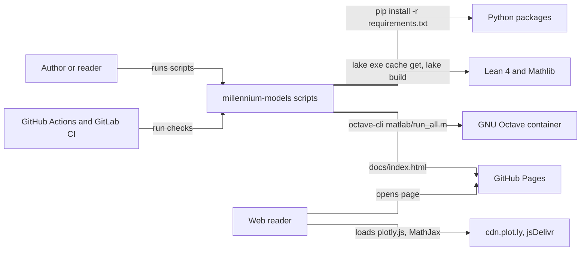
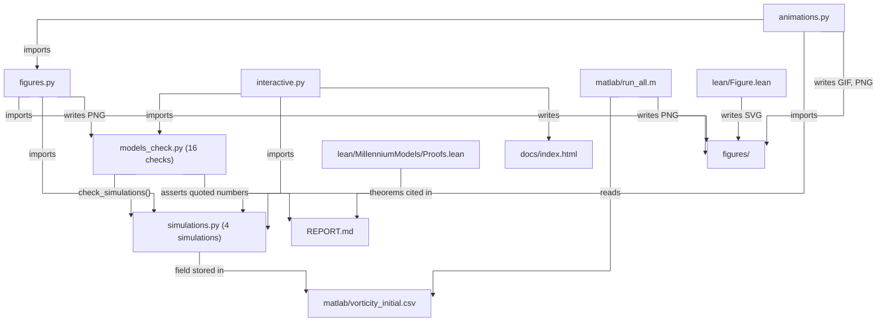
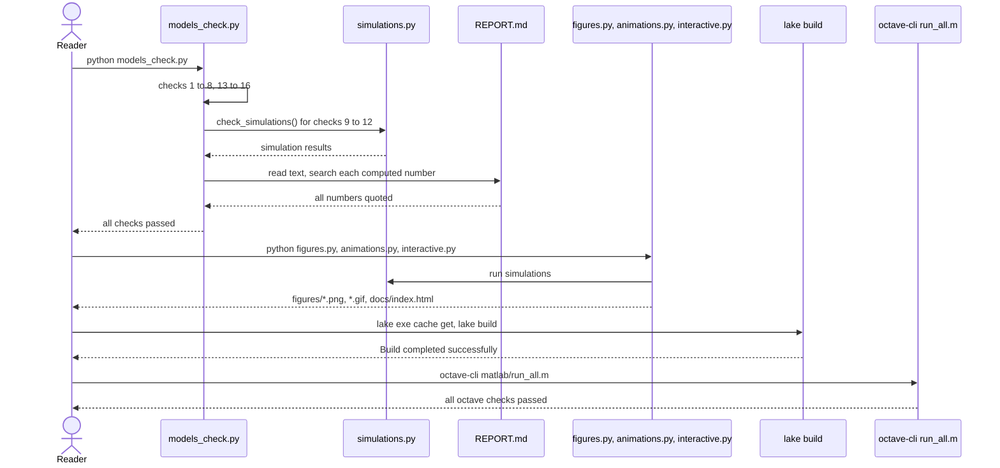

# millennium-models architecture

This document describes the software that produces and checks the report in the arc42 layout. The mathematical content is in [REPORT.md](../../REPORT.md) (in Polish); the project overview is the [project README](../../README.md).

## 1 Introduction and goals

The repository reduces the 7 Millennium Prize Problems to 3 minimal models and one two-thread algorithm. It contains no proof of an open problem: every proposal ends with a named missing step. The software computes the numbers that `REPORT.md` quotes, checks proof cores in Lean 4, repeats 3 simulations in GNU Octave and draws static and interactive figures.

Goals:

| Priority | Goal | Where it shows |
|---|---|---|
| 1 | Every number quoted in `REPORT.md` is computed and checked by code | `models_check.py` asserts that `REPORT.md` quotes each computed number |
| 2 | Proof cores are checked by a proof assistant | `lean/MillenniumModels/Proofs.lean`, 16 theorems, built by `lake build` |
| 3 | Key simulations are repeated in a second language | `matlab/*.m`, run by GNU Octave 11.3.0 through `matlab/run_all.m` |
| 4 | Every figure is reproducible from the repository | `figures.py`, `animations.py`, `interactive.py`, `lean/Figure.lean` |

Stakeholders: the author and readers who want to rerun the checks.

## 2 Constraints

- Python with `numpy`, `matplotlib`, `seaborn`, `plotly`, `pillow` (`requirements.txt`); CI uses Python 3.13.
- Lean `v4.36.0-rc2` and Mathlib `v4.36.0-rc2` (`lean/lean-toolchain`, `lean/lakefile.toml`).
- GNU Octave 11.3.0 in the `gnuoctave/octave:11.3.0` container; the MATLAB files were not run in MATLAB (`REPORT.md`, "Decyzje i braki", row 11).
- The interactive page loads plotly.js and MathJax from CDNs.
- Report text follows the Polszczyzna Kontrolowana (PK) 0.1 rule set (`REPORT.md`, "Decyzje i braki").
- License: MIT (`LICENSE`).

## 3 Context and scope

| Neighbour | Interface |
|---|---|
| Python packages | `requirements.txt`, installed into a virtual environment or by CI. |
| Lean 4 and Mathlib | Lake project in `lean/`; library `MillenniumModels`, executable `figure`. |
| GNU Octave | `docker run ... gnuoctave/octave:11.3.0 octave-cli matlab/run_all.m` (README, step 9). |
| CI | `.github/workflows/ci.yml` (jobs `checks`, `lean`, `octave`) and `.gitlab-ci.yml` (job `checks` on the default branch). |
| GitHub Pages | README links `maciejszulia.github.io/millennium-models` to the page built in `docs/index.html`. |

## 4 Solution strategy

- The report is checked against the code: `models_check.py` fails when `REPORT.md` does not quote a computed number ([ADR 0001](adr/0001-report-numbers-checked-by-code.md)).
- Three independent toolchains check different parts: Python computes, Lean checks proof cores, Octave repeats simulations ([ADR 0002](adr/0002-three-independent-toolchains.md)).
- `models_check.py` and `simulations.py` are the only sources of numbers; figure scripts import them ([ADR 0003](adr/0003-figures-import-computation-modules.md)).
- The interactive page is one generated static HTML file ([ADR 0004](adr/0004-generated-static-interactive-page.md)).

## 5 Building block view

| Block | Responsibility |
|---|---|
| `models_check.py` | 16 checks; prints one line per check; asserts that `REPORT.md` quotes the computed numbers; prints `all checks passed`. Check 4 runs in worker processes (`ProcessPoolExecutor`). |
| `simulations.py` | 4 simulations: curve shortening, 2D vorticity, classical orbits in the $x^2y^2$ potential, 3-SAT search. |
| `figures.py` | 16 PNG figures with matplotlib and seaborn (`Agg` backend); shared style helpers used by `animations.py`. |
| `animations.py` | 3 GIF animations and 1 PNG figure. |
| `interactive.py` | Builds `docs/index.html` with 16 plotly figures. |
| `lean/MillenniumModels/Proofs.lean` | 16 theorems on proof cores, checked with Mathlib. |
| `lean/Figure.lean` | Lean executable `figure`: counts curve points for 45 primes and prints an SVG. |
| `matlab/` | `x2y2_levels.m`, `curve_shortening.m`, `vorticity_2d.m` and `run_all.m`, which compares results with `REPORT.md`. |
| `references-check.md` | Record of the check of 40 references on 2026-11-13. |

## 6 Runtime view

Main scenario: a reader reproduces the computations (README, "Jak powtórzyć obliczenia").

## 7 Deployment view

| Environment | What runs | Evidence |
|---|---|---|
| Local machine | Python virtual environment, Lake, Docker for Octave | README, "Jak powtórzyć obliczenia" |
| GitHub Actions, job `checks` | Python 3.13, `pip install -r requirements.txt`, `python models_check.py` | `.github/workflows/ci.yml` |
| GitHub Actions, job `lean` | `leanprover/lean-action@v1` in `lean/` | `.github/workflows/ci.yml` |
| GitHub Actions, job `octave` | `octave-cli matlab/run_all.m` in `gnuoctave/octave:11.3.0` | `.github/workflows/ci.yml` |
| GitLab CI, job `checks` | `python:3.13-slim`, `python models_check.py`, default branch only | `.gitlab-ci.yml` |
| GitHub Pages | Static `docs/index.html` | README, "Rysunki interaktywne" |

GitHub Actions runs on pushes to `main` and on pull requests.

## 8 Crosscutting concepts

- Evidence tags: report sentences carry tags such as `[obliczenie: skrypt]`, `[źródło: ...]` and `[założenie]` to mark where each claim comes from.
- Assertions as tests: the checks use `assert`; a failed assertion ends the script with an error.
- Number formatting: `pl()` and `thousands()` in `models_check.py` print numbers with a decimal comma, as the Polish report writes them; figure scripts import the same helpers.
- Figure titles state the finding; subtitles state what the figure shows; footers state the source of the numbers (README, "Rysunki").
- Formulas are written in LaTeX; alt texts use Unicode because they cannot render LaTeX (`REPORT.md`, "Decyzje i braki", row 6).

## 9 Architecture decisions

- [ADR 0001: Report numbers checked by code](adr/0001-report-numbers-checked-by-code.md)
- [ADR 0002: Three independent toolchains](adr/0002-three-independent-toolchains.md)
- [ADR 0003: Figure scripts import the computation modules](adr/0003-figures-import-computation-modules.md)
- [ADR 0004: Generated static interactive page](adr/0004-generated-static-interactive-page.md)

## 10 Quality requirements

| Quality | Scenario | Measure |
|---|---|---|
| Correctness | A code change alters a number quoted in `REPORT.md` | `models_check.py` fails with `REPORT.md does not quote: [...]` |
| Correctness | A Lean proof breaks or uses `sorry` | `lake build` fails; `Proofs.lean` contains no `sorry` |
| Reproducibility | Octave results drift from the report | `run_all.m` asserts and fails |
| Performance | `models_check.py` runs locally | 26 s (one run, 2026-11-20, README) |

## 11 Risks and technical debt

- A check covers finitely many cases and is not a proof; simulations carry time-step error (README, "Problematyka").
- Lean theorems take geometry and analysis facts as hypotheses; Lean does not check those facts.
- The MATLAB files were run only in GNU Octave.
- `models_check.py` and `simulations.py` import each other inside functions (`check_simulations()` and a function in `simulations.py` import the other module); a module-level import would create a cycle.
- `requirements.txt` sets lower bounds only, so new package versions can change figure bytes.
- Lean uses release candidate `v4.36.0-rc2`; Mathlib needs about 7.3 GB of disk (`REPORT.md`, "Dowody w Lean").
- The interactive page needs network access to cdn.plot.ly and jsDelivr.
- GitLab CI runs only the Python checks, not Lean or Octave.

### Open questions

- None.

## 12 Glossary

| Term | Definition |
|---|---|
| Model 1 | Surface $E \times E$ with 4 curves and their intersection numbers (Riemann, BSD, Hodge). |
| Model 2 | One number per length scale and the direction in which it changes as the scale shrinks (Poincaré, Yang–Mills, Navier–Stokes). |
| Model 3 | Number of queries of an algorithm and number of gates of a circuit (P vs NP). |
| Two-thread algorithm | Loop that alternately checks texts as proofs and candidates as counterexamples. |
| Check (sprawdzian) | A numbered computation in `models_check.py` that asserts a statement inside a model. |
| Missing step | The named step that a proposal for an open problem does not prove. |
| Lake | Lean 4 build tool. |
| Mathlib | Lean 4 mathematics library. |
| PK | Polszczyzna Kontrolowana, the controlled Polish rule set used in the report. |
